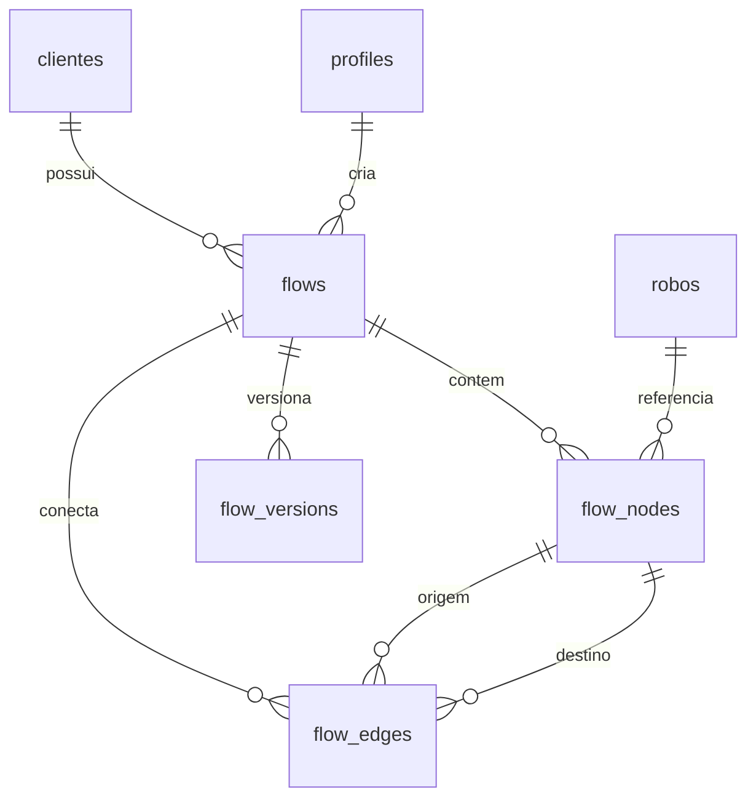
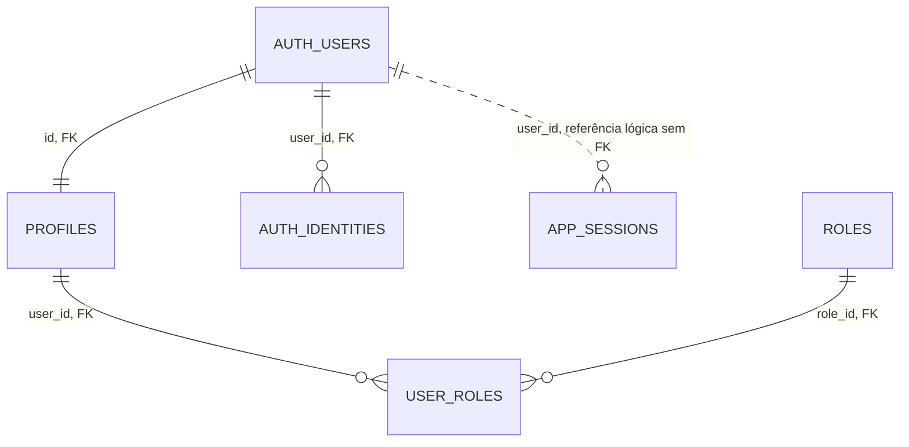

# Modelagem de banco — aplicação PostgreSQL standalone

## 1. Escopo

Este documento descreve o domínio e sua persistência PostgreSQL. O histórico SQL está em supabase/migrations e inclui as alterações do banco standalone; o runtime usa PostgreSQL sem serviço Supabase.

AppDataProvider e FlowsDataProvider consultam o PostgreSQL pelo adapter local; o navegador envia consultas autorizadas a /api/database com o cookie de sessão. Os dados operacionais deixam de depender de mocks durante o uso normal.

## 2. Rotas e consumo de dados

| Rota | Responsabilidade | Fonte de dados |
|---|---|---|
| `/` | Redirecionar sempre para `/login`, inclusive quando existir sessão ativa. | Nenhuma. |
| `/dashboard` | Indicadores calculados, feed e tabela consolidada. | `useAppData()`. |
| `/robos` | Filtrar, cadastrar, importar, editar, excluir e publicar robôs. | `useAppData()` e autorização administrativa. |
| `/configuracoes` | Cadastrar, editar e arquivar usuários e clientes como administrador. | API administrativa e `useAppData()`. |

Usuários e clientes são arquivados por exclusão lógica, preservando histórico e auditoria. No modo standalone, as contas ficam em auth.users e o backend aplica as mesmas verificações de acesso às contas locais.

Dashboard e telas operacionais usam a mesma instância de estado enquanto a aplicação permanece carregada.

Os providers AppDataProvider e FlowsDataProvider consultam o PostgreSQL por meio do adapter local. O adapter atual mantém callbacks periódicos compatíveis com os componentes, mas não recebe eventos reais do banco; uma alteração feita por outra sessão pode levar até 30 segundos para ser refletida. RLS e as policies permanecem responsáveis pela autorização.

Fluxo de leitura: navegador → rotas locais Next.js → adapter PostgreSQL → transação como authenticated com claims → PostgreSQL/RLS → resposta autorizada.

A importação Excel reutiliza o contrato do formulário e persiste os dados no PostgreSQL local. O nome do cliente é normalizado para localizar ou criar um registro em clientes; o tenant obrigatório é gerado de forma única quando o cliente é novo.

A migration `20260807194902_clear_existing_robots_for_import.sql` prepara uma nova carga removendo, nessa ordem, publicações, alterações, regras e robôs. Clientes, profiles, usuários e RBAC são preservados.

A migration `20260807201615_add_robot_badge_colors.sql` adiciona `robos.cliente_cor` e `robos.pacote_cor`, ambas obrigatórias, com defaults compatíveis e constraints limitando os valores às seis paletas suportadas pela interface.

## 3. Entidades

As interfaces estão centralizadas em `src/domain/entities.ts`.

### 3.1. Robô (`Robo`)

Arquivos principais:

- `src/domain/entities.ts`
- `src/domain/validation.ts`
- `src/mocks/app.mock.ts`
- `src/data/AppDataProvider.tsx`
- `src/app/robos/page.tsx`
- `src/components/robos/*`
- `src/components/dashboard/RobotsOverviewTable.tsx`
- `src/components/dashboard/StatsCards.tsx`

| Campo | Tipo TypeScript | Obrigatório | Valores/regras |
|---|---|---:|---|
| `id` | `number` | Sim | Mock numérico ou `Date.now()` no cadastro temporário. |
| `nome` | `string` | Sim | Texto não vazio. |
| `sistema` | `string` | Sim | Snapshot compatível do catálogo `robot_systems`. |
| `system_id` | `uuid` | Sim | FK indexada para `robot_systems`; fonte relacional do Sistema. |
| `pacote` | `string` | Sim | Texto não vazio; filtro próprio. |
| `descricao` | `string` | Sim | Texto não vazio. |
| `ambiente` | `AmbienteRobo` | Sim | `Produção`, `Teste`, `Desenvolvimento`. |
| `ativo` | `boolean` | Sim | Disponível ou indisponível para execução. |
| `stack` | `string` | Sim | Texto não vazio. |
| `fila` | `string` | Sim | Texto não vazio. |
| `versao` | `string` | Sim | Texto não vazio; SemVer não é exigido. |
| `responsavel` | `string` | Sim | Pessoa ou equipe em texto livre; não é `Usuario`. |
| `ultimaPublicacaoEm` | `string` | Sim | Data/hora ISO 8601. |
| `alteracaoRealizada` | `string` | Sim | Pode ser vazio. |
| `regras` | `RegraRobo[]` | Sim | Pode ser vazio; mantém ordem da lista. |

`DadosFormularioRobo` é derivado de `Robo` por `Omit<Robo, "id" | "ultimaPublicacaoEm">`, eliminando a duplicação manual do contrato.

Relacionamentos:

- Robô 1:N Regra do Robô, representado atualmente por composição em `regras`.
- Robô 1:N Publicação, representado por `Publicacao.roboId`.
- Não há relação implementada com Cliente ou Usuário.

### 3.2. Regra do Robô (`RegraRobo`)

| Campo | Tipo TypeScript | Obrigatório | Valores/regras |
|---|---|---:|---|
| `descricao` | `string` | Sim | Texto não vazio após normalização. |

Os códigos visuais `RF001`, `RF002`, `RFD001` etc. são derivados da posição e não pertencem à entidade persistida. Enquanto a aplicação opera com mocks, a ordem é representada pela posição nos arrays `regras` e `regrasForaDocumentacao`.

### 3.3. Publicação (`Publicacao`)

Arquivos principais:

- `src/domain/entities.ts`
- `src/mocks/app.mock.ts`
- `src/data/AppDataProvider.tsx`
- `src/components/dashboard/Feed.tsx`

| Campo | Tipo TypeScript | Obrigatório | Valores/regras |
|---|---|---:|---|
| `id` | `number` | Sim | Mock numérico ou `Date.now()`. |
| `categoria` | `CategoriaPublicacao` | Sim | `Novo Robô`, `Atualização de Regra`, `Atualização do Robô`. |
| `roboId` | `number` | Sim | Referência lógica a `Robo.id`. |
| `descricao` | `string` | Sim | Descrição do evento. |
| `publicadaEm` | `string` | Sim | Data/hora ISO 8601. |

Publicação não embute mais um objeto `Robo`. Cor e texto relativo de tempo são calculados pela interface e não fazem parte da entidade.

O leitor temporário aceita publicações legadas do `localStorage` que possuam `robot.id`, `category` e `description`, convertendo-as ao contrato atual. Novas gravações usam envelope versionado `{ version, items }`.

### 3.4. Usuário (`Usuario`)

Arquivos principais:

- `src/domain/entities.ts`
- `src/domain/validation.ts`
- `src/data/AppDataProvider.tsx`
- `src/app/configuracoes/page.tsx`

| Campo | Tipo TypeScript | Obrigatório | Valores/regras |
|---|---|---:|---|
| `id` | `number` | Sim | Gerado temporariamente com `Date.now()`. |
| `login` | `string` | Sim | Texto não vazio. |
| `tipo` | `TipoUsuario` | Sim | `Admin`, `Operador`, `Cliente`. |

`DadosCadastroUsuario` acrescenta `senha: string` apenas ao fluxo de entrada. Senha não faz parte de `Usuario` e não é mantida no estado da aplicação.

Não há relacionamento entre Usuário e `Robo.responsavel`. Também não há vínculo implementado entre usuário do tipo Cliente e a entidade Cliente.

### 3.5. Cliente (`Cliente`)

| Campo | Tipo TypeScript | Obrigatório | Valores/regras |
|---|---|---:|---|
| `id` | `number` | Sim | Gerado temporariamente com `Date.now()`. |
| `nome` | `string` | Sim | Texto não vazio. |
| `tenant` | `string` | Sim | Texto não vazio; sem formato ou unicidade definidos. |

Cliente é um cadastro independente. Não é Sistema nem Pacote e ainda não possui relacionamento confirmado com Robô ou Usuário.

## 4. Tipos de domínio e valores controlados

| Tipo | Valores |
|---|---|
| `AmbienteRobo` | Produção, Teste, Desenvolvimento. |
| `TipoUsuario` | Admin, Operador, Cliente. |
| `CategoriaPublicacao` | Novo Robô, Atualização de Regra, Atualização do Robô. |

As constantes `AMBIENTES_ROBO`, `TIPOS_USUARIO` e `CATEGORIAS_PUBLICACAO` são a origem única para types e validações.

Stack permanece também como valor textual opcional do Robô e pode referenciar `robot_stacks` por `stack_id` quando informada.

### Solicitações de Stack

`stack_requests` pertence a um Robô e registra nome sugerido, fila opcional, Type, Job, status, Stack gerada e datas de solicitação/conclusão. `stack_request_history` mantém eventos e mensagens imutáveis. Ambas usam UUID, auditoria, índices de relacionamento e RLS. A conclusão não cria nem vincula automaticamente um registro em `robot_stacks`.

## 5. Diagrama textual

```text
Robo 1 ───────< N RegraRobo
  │
  └───────────< N Publicacao
                  Publicacao.roboId -> Robo.id

Cliente    (sem relacionamento implementado)
Usuario    (sem relacionamento implementado)
```

## 6. Proposta inicial de tabelas

Nenhuma tabela foi criada. A tradução inicial, ainda dependente de confirmação, é:

### `robos`

A tabela única `robos` possui `product_type` para segregar os produtos `INTEGRADOR`, `CONSULTA_PROCESSUAL`, `PETICIONAMENTO` e `MOVIMENTO`, sem duplicação de schema. `command` armazena o comando técnico de execução. `tribunal` e `tribunal_system` são opcionais e uma constraint exige que permaneçam nulos em Integradores. O índice parcial `(product_type, nome) where deleted_at is null` atende as listagens por produto. Os registros anteriores à migration são preservados como `INTEGRADOR` e recebem Command vazio.

Além dos campos existentes, armazena `court_name`, `ideal`, `max` e `version_checked_at`. `cliente_id` é obrigatório e o formulário seleciona um registro existente de `clientes`. `pacote` identifica o registro correspondente na fonte de dados do Notion; `version_checked_at` registra somente verificações concluídas com sucesso.

### `alteracoes_robo`

Histórico imutável vinculado por `robo_id`, com `descricao`, `realizada_em`, `created_at` e `created_by`. A migration copia todo `robos.alteracao_realizada` não vazio para esta tabela e preserva a coluna legada para evitar perda de dados.

`id`, `nome`, `sistema`, `pacote`, `descricao`, `ambiente`, `ativo`, `stack`, `fila`, `versao`, `version_checked_at`, `responsavel`, `ultima_publicacao_em`, `alteracao_realizada`.

### `regras_robo`

Materializa `RegraRobo.descricao` e a relação com Robô. A coluna `tipo` separa `documentacao` de `fora_documentacao`; `ordem` é independente por robô e tipo. Os códigos RF/RFD continuam derivados na interface.

### `publicacoes`

`id`, `categoria`, `robo_id`, `descricao`, `publicada_em`.

### `usuarios` ou perfil de autenticação

Dados do perfil: id, login e tipo; a senha não é coluna de profile. No standalone, auth.users guarda o hash bcrypt e public.app_sessions guarda hashes dos tokens de sessão.

### `clientes`

`id`, `nome`, `tenant`.

## 7. Validação atual

Schemas Zod em `src/domain/validation.ts`:

- `dadosFormularioRoboSchema`;
- `regraRoboSchema`;
- `dadosCadastroUsuarioSchema`;
- `dadosCadastroClienteSchema`.

Todos os formulários validam antes de chamar o provedor. Campos obrigatórios do Robô são não vazios; `alteracaoRealizada` e a lista de regras podem estar vazios. A senha mantém a regra existente de mínimo de quatro caracteres.

## 8. Decisões pendentes antes do banco

- Estratégia definitiva de IDs.
- Se `ultimaPublicacaoEm` será `date` ou `timestamptz`; o código agora conserva hora.
- Política de exclusão de robô com publicações existentes.
- ID, ordem e histórico de regras.
- Formato obrigatório de versão.
- Unicidade de nome do robô, login, nome do cliente e tenant.
- Significado técnico de tenant.
- A evolução dos catálogos relacionais de Sistema e Pacote deve preservar os snapshots textuais enquanto houver consumidores legados.

## Módulo de Fluxos por Cliente



### `flows`

`id`, `client_id`, `name`, `description`, `version`, `status`, `viewport`, `created_by`, `created_at`, `updated_at`, `updated_by`.

- `client_id` é obrigatório e usa `on delete restrict`.
- `status` aceita `rascunho` ou `publicado`.
- `viewport` armazena somente `x`, `y` e `zoom`; nodes e edges não são agregados neste JSON.

### `flow_nodes`

`id`, `flow_id`, `type`, `robot_id`, `position_x`, `position_y`, `data`, auditoria e timestamps.

- `type`: `robot`, `trigger`, `system`, `decision`, `note`, `text` ou `group`.
- `robot_id` é obrigatório somente para o tipo `robot`.
- A policy valida que o Robô pertence ao mesmo Cliente do Fluxo.

### `flow_edges`

`id`, `flow_id`, `source_node_id`, `target_node_id`, `source_handle`, `target_handle`, `type`, `label`, `condition`, `queue`, `description`, `label_width`, `label_height`, `label_offset_x`, `label_offset_y`, auditoria e timestamps. `queue` registra opcionalmente a fila vinculada à conexão, sem transformá-la em Node. Dimensões e offsets preservam o tamanho e a posição manual da etiqueta. Os handles opcionais preservam o ponto lateral escolhido; valores nulos representam os pontos principais inferior e superior. Chaves estrangeiras compostas garantem que origem e destino pertençam ao mesmo Fluxo.

### `flow_versions`

`id`, `flow_id`, `version`, `snapshot`, `created_by`, `created_at`. A combinação `(flow_id, version)` é única. Não existem grants ou policies de update/delete para usuários autenticados.

Índices cobrem `client_id`, `flow_id`, `robot_id`, nodes de origem/destino, autoria e ordenação do histórico. Todas as quatro tabelas possuem RLS habilitada.

`flows`, `flow_nodes` e `flow_edges` usam `private.set_flow_row_audit_fields()`, função de auditoria própria para registros sem exclusão lógica. Ela preserva autoria e criação e atualiza `updated_at`/`updated_by`, sem acessar campos `deleted_at` ou `deleted_by` inexistentes nessas tabelas.
- Se Responsável continuará texto ou ganhará entidade própria de equipe/pessoa.
- Relações Cliente–Robô e Cliente–Usuário.
- Sessão local, perfis, papéis e RLS.
- Mínimo definitivo de senha: UI atual usa 4; configuração local do Auth usa 6.

## 9. Riscos de migração restantes

- Publicações antigas do navegador não possuem timestamp real; a compatibilidade não consegue reconstruir textos relativos como data exata.
- IDs baseados em `Date.now()` não são estratégia adequada para concorrência no banco.
- Regras não possuem identidade ou ordem persistida explicitamente.
- Responsáveis podem ser pessoas ou equipes no mesmo campo.
- Dados em memória desaparecem ao recarregar; publicações podem estar fragmentadas por navegador.
- Relacionamentos de Cliente continuam indefinidos e não devem ser inferidos durante a migration.
- A exclusão de robôs com histórico ainda não possui regra de integridade referencial decidida.

## 10. Prontidão

O código está coerente o suficiente para iniciar a próxima etapa de desenho físico, mas a implementação do banco deve aguardar as decisões da seção 8, especialmente autenticação, relações de Cliente, integridade de Publicações e identidade das Regras.
# Implementação V1 aprovada

A persistência inicial está definida pelas migrations em `supabase/migrations`, na seguinte ordem:

1. criação de `clientes`, `profiles`, `roles`, `permissions`, `user_roles`, `role_permissions`, `robos`, `regras_robo` e `publicacoes`, com UUID, constraints, foreign keys, índices e triggers;
2. grants, funções privadas de autorização, RLS e policies;
3. catálogo mínimo e idempotente de papéis e permissões.

auth.users é uma tabela local de compatibilidade e se relaciona 1:1 com profiles. `robos.cliente_id` estabelece o isolamento por cliente. `regras_robo` preserva categoria e ordem das duas listas de regras, e a última publicação permanece um dado derivado de `publicacoes`.

`profiles.cliente_id` é uma FK opcional para `clientes`, com `on delete restrict` e índice próprio. O valor é obrigatório por regra de negócio quando o profile recebe o papel Cliente e pode permanecer nulo ou ser preenchido para Admin, Operador e Suporte.

`profiles.pode_editar_robos_cliente` é booleano, obrigatório e inicia em `false`. A função privada `can_update_robot(uuid)` combina sessão ativa, escopo de Cliente, RBAC administrativo e essa exceção individual. A policy de `robos` repete a função em `USING` e `WITH CHECK`; um trigger impede que Cliente altere `cliente_id`, produto, exclusão lógica, auditoria, documentação e cores compartilhadas.

A migration `20260811140214_protect_client_role_permissions.sql` impede que a matriz global contorne a capacidade individual. As combinações administrativas bloqueadas são validadas tanto pela RPC `update_role_permission_matrix` quanto pela policy de inserção em `role_permissions`.

O papel `master` é um vínculo adicional em `user_roles`, não uma coluna especial em `profiles`. Ele é inicializado exclusivamente para `marcos.vinicius@loylegal.com`, que conserva também `admin`. A permissão `access_control.read` distingue o painel reservado de mapeamento. Policies específicas bloqueiam novas atribuições ou remoções de Master pela aplicação e impedem alterar a role reservada ou sua concessão em `role_permissions`.

A matriz editável continua normalizada em `role_permissions`, sem novas colunas. A RPC `update_role_permission_matrix(jsonb)` recebe somente diferenças confirmadas pela interface e as aplica transacionalmente com `SECURITY INVOKER`. Policies permitem edição irrestrita ao Master e limitam Admin aos papéis Operador, Dev, Cliente e Suporte, excluindo o recurso `access_control`.

As permissões `robots.product.integrador.read`, `robots.product.consulta_processual.read`, `robots.product.peticionamento.read` e `robots.product.movimento.read` segregam a leitura da tabela única `robos`. A policy `robos_select` exige `robots.read`, o produto correspondente e o escopo de Cliente. A migration concede inicialmente os quatro produtos a todos os perfis que já possuíam `robots.read`, preservando o acesso existente.

A migration `20260809130000_add_dev_role.sql` adiciona o papel ativo `dev` e copia, no momento da criação, os vínculos de `role_permissions` do Operador. Os dois papéis permanecem independentes para futuras alterações da matriz. A função `private.can_access_cliente` e a policy `clientes_select` incluem Dev no mesmo escopo global de leitura do Operador.

Os tipos do schema ficam em src/types/database.types.ts. O build não os regenera automaticamente; quando o schema mudar, sincronizar os tipos com o PostgreSQL standalone e revisar os contratos de API.

## Progresso do tutorial

`user_tutorial_progress` persiste o onboarding por usuário, chave e versão. A identidade funcional é a combinação única `user_id`, `tutorial_key` e `tutorial_version`; `status`, `current_step`, `started_at` e `completed_at` permitem iniciar, retomar, pular, concluir e executar novamente sem depender do navegador. Os textos e passos continuam definidos em código nesta fase.

## Administração de tutoriais

`tutorials` mantém nome, chave, público relacionado a `roles`, status e versão publicada atual. `tutorial_drafts` é o rascunho 1:1; `tutorial_steps` normaliza ordem, página lógica, target catalogado, conteúdo, posição, condição e habilitação. `tutorial_versions` preserva snapshot JSONB completo e imutável de cada publicação. `user_tutorial_progress.tutorial_id` é opcional para preservar os registros anteriores da Fase 1 e passa a identificar tutoriais administrativos.

As RPCs `create_tutorial`, `save_tutorial_draft` e `publish_tutorial` usam `SECURITY INVOKER`, validam `tutorials.manage` e executam criação, substituição ordenada do rascunho e publicação na mesma transação. O snapshot publicado nunca é reconstruído a partir do rascunho atual.

## Atualização de capacidade e papel Suporte

A migration `20260807221053_add_support_role_and_robot_capacity_permission.sql` adiciona o papel `suporte`, a permissão `robots.capacity.update` e a RPC `public.update_robot_capacity(uuid, integer, integer)`. A função revoga execução de `PUBLIC` e `anon`, exige sessão autenticada e permissão específica e atualiza exclusivamente `robos.ideal` e `robos.max`.

Operador deixa de possuir manutenção completa de robôs e recebe somente atualização de capacidade. Cliente e Operador não acessam Configurações. Suporte recebe as leituras necessárias para Dashboard, Robôs e Fluxos; a camada de rotas permite essas consultas e continua bloqueando Configurações e qualquer manutenção.

## Cor centralizada do Cliente

A migration `20260807230000_add_client_color.sql` adiciona `clientes.cor`, com valor obrigatório limitado às seis paletas da aplicação. A carga inicial preserva a primeira `robos.cliente_cor` ativa encontrada para cada cliente e usa `azul` quando não existe robô relacionado. A coluna legada em `robos` permanece temporariamente para compatibilidade e não é removida.

`pacote_cor` continua em `robos`. A aplicação mantém a mesma cor para todos os pacotes cujo nome normalizado seja igual.

## Persistência do feed de atualizações

O componente **Atualizações recentes** lê `public.publicacoes`, ordenada por `publicada_em` decrescente. A ação **Salvar e publicar** insere o evento nessa tabela pelo adapter PostgreSQL autenticado. `localStorage` não é fonte de persistência para novas publicações.

## Manual PDF do robô

`robot_uploaded_documents` registra os metadados dos anexos privados do robô: caminho, nome original, MIME, tamanho e auditoria. A área lógica `robot-manuals` aceita PDF, DOCX e XLSX de até 20 MB, usando caminhos únicos sob `<robo_id>/`; os bytes são armazenados no filesystem sob `DOCUMENT_STORAGE_DIR/robot-manuals`, e as rotas autenticadas aplicam o escopo de acesso ao robô/cliente. A área não é um bucket Supabase. Os campos legados `robos.manual_path` e `robos.manual_nome` são preservados. A cópia para a infraestrutura não leva os metadados documentais nem os arquivos; referências legadas podem apontar para arquivos que precisarão ser cadastrados manualmente.

## Orçamentos

`budget_action_catalog` é a fonte única das ações, categorias, horas padrão, ordem e estado ativo usados pela criação manual e pelo parser de TXT. `budget_action_aliases` registra os termos normalizados reconhecidos no arquivo e sua prioridade; aliases mais prioritários e específicos são avaliados antes dos genéricos.

`budgets` persiste nome, origem (`manual` ou `txt`), estado, parâmetros financeiros e totais congelados. O conteúdo e nome do TXT podem ser preservados para rastreabilidade. `client_id`, `system_id` e `robot_id` são FKs opcionais: o orçamento pode ser salvo sem Cliente, Sistema e Robô. `system_id` referencia o catálogo `robot_systems` e possui índice para consultas e indicadores futuros.

`budget_items` mantém o snapshot da descrição, horas, valor-hora, valor e linha de origem. Alterações posteriores no dicionário não recalculam registros históricos. Todas as tabelas possuem auditoria, índices, grants explícitos e RLS limitada a Master/Admin.

```text
budget_action_catalog (1) ── budget_action_aliases (0..N)
          │
          └── budget_items (0..N) ── (1) budgets ── (0..1) clientes
                                             └──── (0..1) robot_systems
                                             └──── (0..1) robos
```

`public.save_budget` é uma RPC `SECURITY INVOKER` que cria ou edita o orçamento e substitui seus itens na mesma transação. Horas, subtotal e valor estimado são recalculados no banco a partir dos itens; a função valida Master/Admin, Cliente ativo e dados financeiros antes de gravar.

`budgets.status` aceita `novo`, `enviado_comercial`, `projeto_rejeitado`, `arquivado` e `aprovado`. O default é `novo`, e a RPC ignora qualquer tentativa de criar diretamente em outro estado. Registros legados `draft`/`finalized` são migrados para `novo` sem exclusão.

## Base da Documentação Robot Center

O editor mantém `regras_robo` como fonte de verdade. `parent_id` referencia uma regra raiz do mesmo robô e tipo e permite um nível de sub-regra; `ordem` é posicional entre irmãos. Códigos como `RF003.001` são derivados e nunca identificadores.

`robot_center_documentation_sections` armazena as seis seções fixas do rascunho. `robot_center_documentation_blocks` armazena conteúdo complementar vinculado ao UUID real da regra e está preparado para `text`, `note`, `image`, `caption` e `page_break`; a primeira interface edita `text` e `note`.

Blocos agora podem pertencer a uma regra (`requirement_id`) ou seção (`section_id`), nunca às duas. `metadata` registra caminho, MIME, nome original, tamanho, dimensões, alinhamento e preset da imagem; os bytes ficam no filesystem persistente sob `DOCUMENT_STORAGE_DIR/robot-documentation/<robo_id>/draft/images/<uuid>.<ext>`. Legendas são blocos `caption` ligados à imagem por `related_block_id`. `robot-documentation` é uma área lógica, não um bucket Supabase.

- `robot_center_documentations`: raiz 1:1 com `robos`, status, auditoria e exclusão lógica; não contém o arquivo externo nem conteúdo editorial.
- A unicidade de `robot_center_documentations` por robô considera somente registros com `deleted_at is null`, permitindo uma nova documentação após exclusão lógica sem sobrescrever o histórico anterior.
- A RPC `initialize_robot_center_documentation` resolve conflitos pelo índice parcial `robot_center_documentations_robo_active_key`, usando o predicado `deleted_at is null`. Ela reutiliza a documentação ativa quando existente ou cria uma nova após exclusão lógica, sem depender da constraint global removida.
- `robot_center_documentation_drafts`: rascunho 1:1 com a raiz. Nesta etapa armazena somente a revisão e auditoria.
- `robot_center_documentation_versions`: futuras versões publicadas, únicas por documentação e número. Um trigger bloqueia `UPDATE` e `DELETE`.

### Publicação da Documentação Robot Center

`robot_center_documentation_templates` registra o template DOCX mestre ativo, armazenado no filesystem persistente sob `DOCUMENT_STORAGE_DIR/robot-documentation-templates`. Essa área lógica não é um bucket Supabase. A publicação reserva uma linha em `robot_center_documentation_versions` com estado `generating`, número sequencial e token idempotente. Após gerar os artefatos, a linha recebe `snapshot`, `docx_path`, `pdf_path`, template utilizado e `published_at`; versões `published` não aceitam atualização nem exclusão. Falhas ficam em `failed` e são reprocessadas no mesmo número.

Os arquivos publicados ficam no filesystem persistente em `DOCUMENT_STORAGE_DIR/robot-documentation/<robo_id>/versions/v1.x/`. Imagens do rascunho são copiadas para a pasta da versão antes da geração, portanto substituições futuras no rascunho não alteram snapshots publicados. `robot_center_documentations.current_version_id` referencia a versão publicada atual.

Ao concluir uma versão, a mesma transação insere uma linha em `publicacoes` com categoria `Atualização do Robô`. Assim, a dashboard reutiliza seu feed existente sem duplicar entidade nem introduzir uma categoria incompatível.

```text
robos
  ├── robot_uploaded_documents (0..N) -> robot-manuals (Documentação Upada)
  └── robot_center_documentations (0..1)
        ├── robot_center_documentation_drafts (0..1)
        └── robot_center_documentation_versions (0..N, imutáveis)

robos (1) ── regras_robo (0..N, fonte de verdade das RFs)
```

A migration `20260808223000_prepare_robot_center_documentation.sql` é somente aditiva. Snapshot, artefatos DOCX/PDF e blocos editoriais serão modelados nas etapas que implementarem essas funcionalidades.

A migration `20260808224500_allow_published_robot_documentation_view.sql` separa a leitura publicada da edição: papéis que já possuem `robots.read` recebem `robot_center_documentation.read`, mas as policies retornam apenas documentos `published`. Admin com `manage` continua autorizado a consultar a preparação e o rascunho.

## Disparo e relacionamentos entre robôs

`robos.disparo` aceita `Agendado`, `Manual` ou `Gatilho`. `gatilho_de_robo_id` e `gatilho_para_robo_id` são chaves estrangeiras opcionais para `robos.id`, indexadas para futuras consultas de fluxo. Um trigger impede autorreferência, robôs excluídos e relações entre clientes diferentes.

## Exclusão permanente de Robôs

`private.robot_deletion_audit` preserva `robot_id`, o snapshot JSON completo, autor e instante antes de cada exclusão física. Alterações, publicações, regras e metadados de anexos usam cascata porque pertencem ao Robô. `flow_nodes.robot_id`, `stack_requests.robot_id`, `robot_center_documentations.robo_id` e os gatilhos entre Robôs usam `ON DELETE SET NULL` para preservar históricos independentes.

## Preferências dos quadros da Dashboard

`dashboard_chart_preferences` mantém uma linha por usuário, referenciada por `user_id`. `cards` é um array JSON limitado a 20 itens e 30 KB, contendo somente identificador, contexto e tipo visual do quadro. As policies exigem `auth.uid() = user_id` em SELECT, INSERT, UPDATE e DELETE; nenhum usuário consulta ou altera o layout de outro.
## Distribuição automática de cores

`clientes.cor` guarda a cor visual única do cadastro do cliente. `robos.pacote_cor` é sincronizada por nome normalizado de pacote: o trigger `robos_set_package_color` reutiliza a cor existente ou escolhe a próxima opção da paleta para pacotes inéditos. A migration preserva os registros e não altera as policies RLS.

## Importação e atualização em lote

A planilha usa `robos.id` como chave de atualização e não cria unicidade artificial sobre nome ou CourtName. Updates enviam apenas colunas preenchidas. A estrutura do banco não muda e inserts/updates continuam sujeitos às policies existentes.

O modelo de importação inclui `product_type` por meio da coluna visual Produto. A base exportada é segregada pelo produto da página atual, enquanto o modelo sem dados de robôs contém cabeçalhos, validações, instruções e Produto previamente preenchido com o contexto da página. A importação persiste o tipo selecionado na mesma tabela `robos`.
## Tarefas pessoais

`personal_tasks` armazena a organização diária de cada usuário. `user_id` referencia `profiles.id`; `client_id` referencia opcionalmente `clientes.id` com `on delete set null`; `due_date`, `priority`, `status`, `created_at` e `completed_at` suportam os filtros e o resumo da página. As prioridades aceitas são urgente, alta, média e baixa. O status inicia em `todo` (A Fazer) e percorre os estados operacionais até `completed`. Os índices `(user_id, due_date, created_at)`, `(user_id, status, due_date)` e o índice parcial de `client_id` atendem às consultas sem varredura entre usuários. Um trigger preserva proprietário e criação, atualiza `updated_at` e mantém `completed_at` preenchido exclusivamente para ToDos concluídos.

Na interface, essa entidade é denominada exclusivamente **ToDo**. `note` aceita texto simples legado ou o HTML controlado do editor de blocos. `origin_meeting_id` e `origin_note_id` são referências opcionais e mutuamente exclusivas. O trigger valida que a origem pertence ao mesmo `user_id` do ToDo.

`personal_meetings` registra nome, data, horário, participantes, resumo e anotações livres. O índice `(user_id, meeting_date, meeting_time)` atende filtros cronológicos pessoais.

`personal_notes` registra título e conteúdo livre. O conteúdo permanece em coluna `text` e aceita tanto texto simples legado quanto a marcação controlada do editor rico da interface. O índice `(user_id, updated_at desc)` atende listagem e busca pessoal ordenada pela edição mais recente.

`personal_page_preferences` mantém uma linha por usuário e controla a exibição da tabela de robôs. `personal_page_flows` é a relação N:N entre usuário e os fluxos escolhidos como atalhos, com FKs para `profiles` e `flows`. A exclusão de um fluxo remove somente seus atalhos por cascata; não altera outras preferências nem tarefas.
## Arquivamento de Cliente pelo Master

`archive_client_with_user_reassignment` atualiza atomicamente `profiles.cliente_id` e `clientes.deleted_at`. O Cliente substituto, quando informado, deve existir e estar ativo. A operação preserva o trigger que bloqueia Clientes com Robôs ativos e não remove entidades ou históricos.
# Atualização: flag Kortex dos robôs

`public.robos.kortex` é um booleano obrigatório, com padrão `false`, que indica se o robô utiliza Kortex. O campo pertence à própria entidade `robos` e não altera seus relacionamentos.

## Sessões próprias da aplicação

`public.app_sessions` registra sessões emitidas pelo backend Robot Center. A tabela contém `id`, `user_id`, `token_hash` SHA-256, `created_at`, `expires_at`, `last_seen_at` e `revoked_at`. `user_id` identifica a conta existente sem copiar, renomear ou remover usuários. O token bruto permanece somente no cookie HttpOnly; o banco armazena seu hash. Índices atendem à validação e revogação de sessões ativas. RLS fica habilitada e a tabela não concede acesso a `PUBLIC`, `anon` ou `authenticated`; somente o backend privilegiado pode operá-la.

## Compatibilidade de autenticação PostgreSQL standalone

No PostgreSQL standalone, `auth.users` preserva a identidade da conta, os hashes de senha e os metadados necessários ao backend. `auth.identities.user_id` referencia `auth.users.id` com exclusão em cascata. `public.profiles.id` também referencia a mesma conta. O login da aplicação compara a senha com `auth.users.encrypted_password`; não há serviço GoTrue no servidor standalone.

`auth.uid()` e `auth.jwt()` leem as claims definidas pelo backend durante cada transação. Elas mantêm as policies e funções existentes sem enviar JWT ou credenciais do Supabase ao navegador. `service_role` acessa apenas as colunas de conta usadas pelo servidor; `authenticated` e `anon` não recebem acesso direto às tabelas `auth.users` e `auth.identities`.

`public.app_sessions` contém apenas sessões novas emitidas pela aplicação local. Sessões antigas não são copiadas; depois da troca de banco, cada usuário autentica novamente. A importação preserva `auth.users` e `auth.identities`, mas exclui dados de documentos e arquivos. As tabelas de documentação continuam criadas pelas migrations para que o fluxo possa ser testado vazio; o conteúdo binário fica em `DOCUMENT_STORAGE_DIR`.

As tabelas `storage.buckets` e `storage.objects`, junto de `storage.foldername(text)`, existem como compatibilidade para as policies presentes no histórico. O armazenamento atual da aplicação grava os bytes no filesystem local; linhas e arquivos de `storage.objects` não fazem parte da importação.

O trigger compartilhado `private.set_row_audit_fields()` atualiza os campos comuns de auditoria. Como ele também atende tabelas sem exclusão lógica, a migration standalone verifica `deleted_at` e `deleted_by` dinamicamente antes de preenchê-los.




## Estado verificado da cópia standalone — 16/10/2026

A cópia inicial do schema e dos dados foi feita do banco local `supabase_db_robot-center` para `robot_center_migrated`, sem alterar a origem. Naquele restore, os dois bancos tinham 45 tabelas public/private, 122 policies, 57 funções e 44 tabelas públicas com RLS; as contagens coincidiam nas 37 tabelas de produto importadas. As seis tabelas de conteúdo da Documentação Robot Center, `robot_uploaded_documents`, `storage.objects` e `app_sessions` foram mantidas sem dados na cópia inicial, conforme o escopo combinado. A migration posterior de recuperação acrescentou `app_password_reset_tokens`; os dados de sessões e tokens locais devem continuar fora do dump corporativo.

As contas `auth.users` e `auth.identities`, perfis, papéis e permissões foram preservados. Na cópia inicial, o destino continha 14 contas e 14 identidades; o perfil `marcos.vinicius` mantém os papéis `admin` e `master`. `public.app_sessions` foi importada sem sessões, portanto cada usuário precisou entrar novamente. Logins posteriores criam sessões locais; sessões de desenvolvimento e tokens de recuperação não devem ir no dump corporativo. O trigger `on_auth_user_created` cria um perfil para novas contas.

As migrations históricas do banco de origem foram registradas no destino, seguidas pelas migrations standalone locais. authenticated mantém as policies RLS e os grants dos helpers privados; service_role fica restrito ao backend, com acesso por coluna a auth.users e sem acesso a auth.identities.

O campo robos.manual_path ainda contém uma referência a um PDF que não foi copiado. O arquivo não está disponível no destino até ser importado por um procedimento separado; o dado de origem foi preservado.

## Recuperação de senha standalone

`public.app_password_reset_tokens` registra solicitações de redefinição sem substituir ou alterar a identidade em `auth.users` até o usuário confirmar a nova senha. A tabela contém `id`, `user_id` (FK para `auth.users.id`, com cascade na exclusão física), `token_hash` SHA-256 único, `created_at`, `expires_at` e `used_at`. A aplicação armazena apenas o hash do token; o token bruto é entregue no link local de desenvolvimento ou, futuramente, pelo SMTP de produção.

Índices atendem à invalidação por usuário e à consulta de tokens ainda não consumidos. RLS fica habilitada, sem policies ou grants para `PUBLIC`, `anon` e `authenticated`; somente `service_role` opera a tabela pelo backend. O token vence em 30 minutos, é de uso único e novas solicitações invalidam as anteriores. A redefinição atualiza o hash bcrypt da conta, consome tokens pendentes e revoga sessões ativas.

Relacionamento de autenticação:

```text
AUTH_USERS ||..o{ APP_SESSIONS : "user_id"
AUTH_USERS ||..o{ APP_PASSWORD_RESET_TOKENS : "user_id"
```
